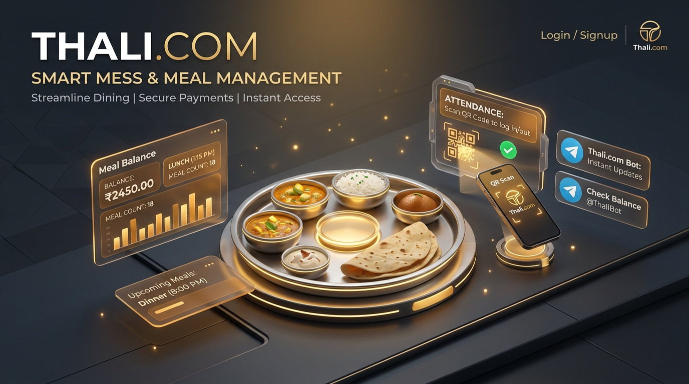
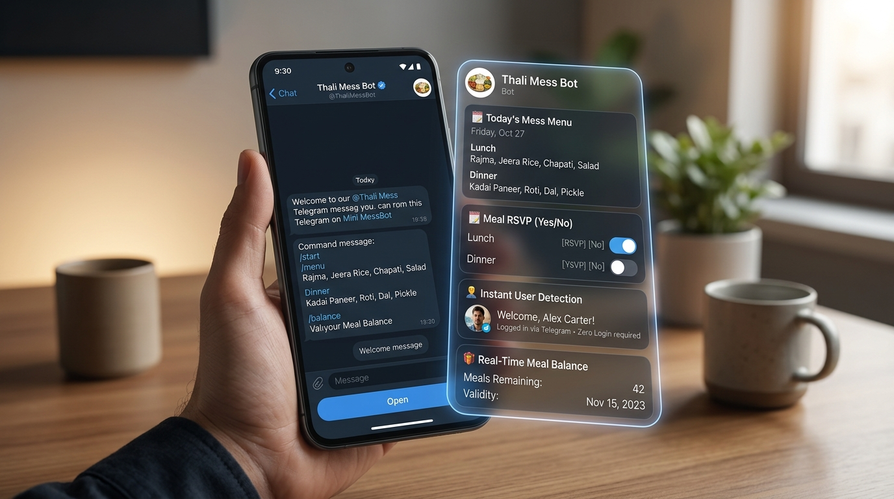
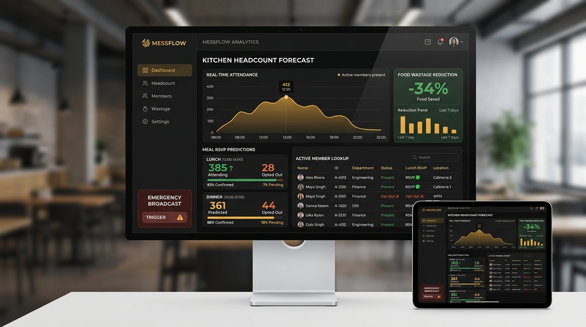

<div align="center">

  

  # 🍽️ Thali.com
  ### Smart Mess Membership, Real-Time QR Check-In & Native Telegram Mini App

  [](https://thali-com.vercel.app)
  [](https://thali-com.vercel.app/telegram)
  [](https://t.me/ThaliMessBot)
  [](https://t.me/ThaliAdminBot)

  <br />

  [](https://react.dev/)
  [](https://www.typescriptlang.org/)
  [](https://vitejs.dev/)
  [](https://supabase.com/)
  [](https://web.dev/progressive-web-apps/)
  [](LICENSE)

  <p align="center">
    <strong>A high-throughput dining ecosystem serving 400+ members daily with zero manual registers, zero queue bottlenecks, and automated kitchen headcount forecasting.</strong>
  </p>

</div>

---

## ⚡ The Modern Mess Problem & Solution

Traditional mess operations rely on paper registers, manual tick-marks, and estimated food quantities that lead to **30%+ kitchen food wastage** and long queue delays during peak meal times.

| ❌ Traditional Register Mess | ✅ Thali.com Ecosystem |
| :--- | :--- |
| Paper logs, lost records, and proxy meals | **Anti-duplicate QR Pass** verified in under 100ms |
| Blind cooking leading to huge food wastage | **Real-time Kitchen Headcount Forecast** via 1-tap RSVP |
| Manual notices stuck on noticeboards | **Instant Telegram Broadcasts** delivered in seconds |
| Forgot login password or registration card | **Zero-Login Telegram Mini App** auto-detects member ID |
| Disputed meal counts and cash tracking | **Atomic PostgreSQL Ledger** with instant balance tracking |

---

## 🌟 Feature Tour

### 1. Instant Digital QR Pass & Fast Counter Check-In
> High-contrast, dynamic digital pass engineered for low-light cafeteria environments with anti-screenshot security tokens.

<div align="center">
  
</div>

- **⚡ Sub-100ms Verification:** Counter staff scans member QR with real-time audio-visual confirmation.
- **🛡️ Anti-Proxy Protection:** Automatic cooldown timer and rolling hash prevent QR sharing or screenshot fraud.
- **📊 Live Balance Meter:** Instant meal count decrement and validity countdown visible to both student and cashier.
- **📲 PWA Offline Caching:** Members can present their pass even in campus basement areas with weak network connectivity.

---

### 2. Native Telegram Mini App & Dual-Bot Companion
> Zero login friction. Members access menus, balance, and passes directly inside Telegram with BotFather-grade native styling.

<div align="center">
  
</div>

- **🔑 Zero-Login Auto Authentication:** Mini App automatically reads `Telegram.WebApp.initDataUnsafe.user` and pairs with the member account instantly.
- **🌓 BotFather Native UI/UX:** Matches Telegram client theme seamlessly (slate dark `#17212b` & clean light modes) with zero landing-page clutter.
- **🍱 Today's Menu & 1-Tap RSVP:** Members can vote `Attending` or `Skip` for Lunch and Dinner in 1 click.
- **🤖 Dual-Bot Architecture:**
  - **[@ThaliMessBot](https://t.me/ThaliMessBot):** Student companion for daily menus, passes, balance, and closure alerts.
  - **[@ThaliAdminBot](https://t.me/ThaliAdminBot):** Dedicated administrative console with phone-authenticated access for mess owners.

---

### 3. Kitchen Headcount Forecast & Admin Operations
> Predictive analytics and instant mess controls that eliminate kitchen food waste and streamline inventory.

<div align="center">
  
</div>

- **📉 Food Wastage Reduction:** Accurate headcount forecast before food prep starts, cutting overproduction by up to 34%.
- **📢 Emergency Mess OFF Broadcast:** Declare all-day or meal-specific closures (e.g., Festival / Renovation) with automatic member alerts and dish list suppression.
- **💳 Plan Top-Ups & Member Directory:** Search 400+ members by name or ID (`M-112`), adjust meal balances, and record cash/UPI payments.
- **🔒 Role-Based Access Control:** Separate optimized views for Members, Receptionists, and Mess Admins.

---

## 🛠️ Technology Stack & Architecture

```
                          ┌────────────────────────┐
                          │   Telegram Clients     │
                          │  (Mobile, Web, Desktop)│
                          └───────────┬────────────┘
                                      │
            ┌─────────────────────────┼─────────────────────────┐
            │                         │                         │
            ▼                         ▼                         ▼
   ┌───────────────────┐    ┌───────────────────┐    ┌───────────────────┐
   │  @ThaliMessBot    │    │  Telegram Mini App│    │  @ThaliAdminBot   │
   │  (Node Bot API)   │    │  (/telegram Route)│    │  (Manager Portal) │
   └────────┬──────────┘    └─────────┬─────────┘    └─────────┬─────────┘
            │                         │                        │
            └─────────────────────────┼────────────────────────┘
                                      │
                                      ▼
                        ┌──────────────────────────┐
                        │   Vite + React 19 SPA    │
                        │ (PWA, Tailwind, Lucide)  │
                        └─────────────┬────────────┘
                                      │
                                      ▼
                        ┌──────────────────────────┐
                        │     Supabase Cloud       │
                        │ ──────────────────────── │
                        │  • PostgreSQL DB         │
                        │  • Row Level Security    │
                        │  • Real-time Attendance  │
                        │  • Atomic Meal Ledgers   │
                        └──────────────────────────┘
```

- **Frontend:** React 19, TypeScript, Vite, Tailwind CSS, Lucide Icons, Canvas Confetti
- **Telegram Ecosystem:** Telegram WebApp SDK, Telegram Bot API, Native Long-Polling Daemons
- **Backend & Database:** Supabase (PostgreSQL, Row Level Security, Realtime Subscriptions, Database Functions)
- **Deployment & Hosting:** Vercel (Edge Network with SPA Rewrites), Node.js Runtime

---

## 🚀 Getting Started Locally

### Prerequisites
- Node.js `v20+` or `v26+`
- A free [Supabase](https://supabase.com) project
- Telegram Bot Tokens from [@BotFather](https://t.me/BotFather) (Optional for bot features)

### 1. Clone & Install
```bash
git clone https://github.com/TanishkGoswami/Thali.com.git
cd Thali.com
npm install
```

### 2. Configure Environment Variables
Create a `.env` file in the project root:
```env
# Supabase Configuration
VITE_SUPABASE_URL=https://your-project.supabase.co
VITE_SUPABASE_ANON_KEY=your-anon-key

# Telegram Bot Engine (Optional for bot services)
TELEGRAM_BOT_TOKEN=your-student-bot-token
TELEGRAM_ADMIN_BOT_TOKEN=your-admin-bot-token
```

### 3. Run Development Server
```bash
# Start frontend web app & Telegram Mini App preview
npm run dev
```
Visit `http://localhost:5173` for the web app, or `http://localhost:5173/telegram` for the Telegram Mini App.

### 4. Run Telegram Bot Daemon (Optional)
```bash
# Starts both @ThaliMessBot and @ThaliAdminBot with live command handlers
npm run bot
```

---

## 📂 Project Organization

```
Thali.com/
├── public/                 # Static assets, PWA manifests, icons
├── src/
│   ├── components/         # Modular views (Member, Admin, Receptionist)
│   │   └── TelegramMiniApp.tsx  # Native BotFather-styled Mini App
│   ├── lib/                # Supabase client, auth helpers, sounds
│   ├── types/              # Strict TypeScript interfaces
│   ├── App.tsx             # Root router & role guard
│   └── main.tsx            # Application entrypoint
├── scripts/
│   └── telegramBot.js      # Dual-bot engine with sync & broadcast logic
├── supabase/
│   └── migrations/         # PostgreSQL DDL, tables, views, RLS policies
├── docs/                   # Complete architectural & operational docs
│   ├── assets/             # Showcase graphics, diagrams, UI frames
│   ├── PRD.md              # Product requirements document
│   ├── DATABASE_SCHEMA.md  # Relational schema & ledger designs
│   └── TECH_STACK.md       # Technical specs & security policies
└── vercel.json             # SPA rewrite rules for production deployment
```

---

## 📚 Deep Dive Documentation

For in-depth operational guidelines and engineering details, refer to the [`docs/`](./docs/) directory:

- 📑 [**Product Requirements Document (PRD)**](./docs/PRD.md)
- 🗄️ [**Database Schema & Atomic Ledgers**](./docs/DATABASE_SCHEMA.md)
- 🔐 [**Security & Row Level Security (RLS)**](./docs/SECURITY_RLS.md)
- ⚖️ [**Business Rules & Validity Policies**](./docs/BUSINESS_RULES.md)
- 🎨 [**Design System & Style Guidelines**](./docs/DESIGN.md)

---

<div align="center">
  <p>Crafted with ❤️ for students, foodies, and mess managers.</p>
  <p><strong>Thali.com — Smart dining made effortless.</strong></p>
</div>
